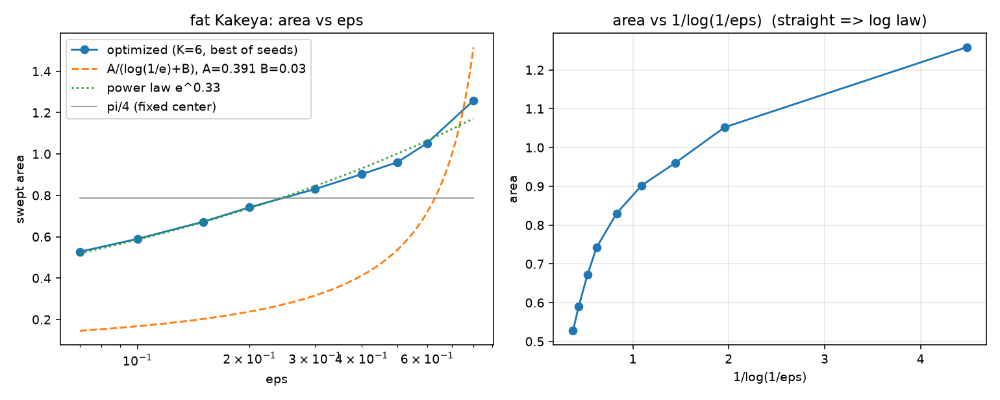

<p align="center"><strong>简体中文</strong> · <a href="README.md">English</a></p>

<div align="center">
  
</div>

<h1 align="center">fat_kakeya_needle</h1>

<p align="center"><strong>把针的扫掠做得更小，把算力换来的改进量说清楚，把数值与证明分开。</strong></p>

<p align="center">研究 1×ε 矩形针在平面上自由运动、连续旋转 180° 时的最小扫掠面积。</p>

当 ε→0 时，针可以在任意小的面积里掉头。真正难的是：面积到底掉得多快，有限 ε 下哪种运动最接近极限，以及哪些结论真的能被证明。这个仓库把三件事分开做：候选运动、可复现的“算力→质量”标度、以及针对指定运动的精确有理上界。

## 一眼看懂

- **ε = 0.002 的浮点最好候选：** K=256 光滑枢转＋滑移运动的数值区间 `0.310335–0.310376`（`n_sub=160`）。这是候选构造的数值估计，**不是**证书，也不是已证明的最小值。
- **指定连续运动的严格上界：** ε=.05 → `4489/8192 ≈ 0.547974`；ε=.002 → `673359/2097152 ≈ 0.321083`；ε=.005 网格胜者 → `3203055/8388608 ≈ 0.381834`。
- **理论：** 对不受限的连续运动，`f(ε) = Θ(1/log(1/ε))`。固定 K 的枢转族有正面积障碍：每个等角枢转段至少扫出 `π/(8K)`。
- **算力标度：** `q(B) = q∞ + c/B`；光滑族拟合 `q∞ = 0.3442`（R² = 0.975），与存档最优 `0.344088` 相差 0.04%。
- **状态：** v1.0 研究里程碑已达成，当前为可复现与可扩展而维护。



*早期 37 点诊断图：在可计算范围内没有出现理论对数律的平台。当前 8 个 ε 点、84 格的正式扫描见 [docs/eps-sweep-condition1.md](docs/eps-sweep-condition1.md)。*

## 快速开始

需要 Python 3.12。证明路径只用标准库，所以第一个结果不需要装任何依赖：

```bash
# 1. 克隆后直接复算一份精确有理上界（仅标准库）
git clone https://github.com/ZisIsNotZis/fat_kakeya_needle.git
cd fat_kakeya_needle
python3 rational_pivot_certificate.py results/coarse_refine_0002_K256.json \
  --seed 0 --q 2048 \
  --verify results/rational_pivot_0002_K256_seed0_q2048.json
```

```bash
# 2. 跑优化器和包络前，装数值栈
python3 -m venv .venv
source .venv/bin/activate
python3 -m pip install numpy scipy shapely matplotlib
python3 -m pip install pyclipper==1.4.0   # 可选的整数多边形后端
```

记录下来的环境是 Python 3.12 加 `numpy`、`scipy`、`shapely`、`matplotlib`，以及可选的 `pyclipper==1.4.0`；具体版本、哈希和陷阱见 [`WORKSPACE.md`](WORKSPACE.md)。

```bash
# 3. 跑最小回归集
python3 -m unittest -v test_pivot_enclosure test_v2_numerical_enclosure \
  test_rational_pivot_certificate test_keich_motion
```

## 现在能做什么

| 能力 | 仓库提供什么 | 从哪里开始 |
| --- | --- | --- |
| 建模连续运动 | 关键帧、枢转＋滑移、光滑剖面、层次滑移四族，以及显式的 Keich 理论递推 | [`sweeper_v2.py`](sweeper_v2.py)、[`pivot_slide.py`](pivot_slide.py)、[`smooth_pivot.py`](smooth_pivot.py)、[`hierarchical_pivot.py`](hierarchical_pivot.py)、[`keich_motion.py`](keich_motion.py) |
| 评估一条运动 | Shapely 浮点包络、整数多边形后端、连续运动适配器 | [`strict_bound.py`](strict_bound.py)、[`v2_numerical_enclosure.py`](v2_numerical_enclosure.py)、[`integer_motion_area.py`](integer_motion_area.py)、[`motion_adapters.py`](motion_adapters.py) |
| 证明一个上界 | 对指定枢转 JSON 运动做精确有理外包网格计数，附源文件哈希与独立 `--verify` 复算 | [`rational_pivot_certificate.py`](rational_pivot_certificate.py)、[证书说明](docs/rational-pivot-certificate.md) |
| 在预算下搜索 | 差分进化＋局部精修、独立冷启动、总进程 CPU 计费，以及拒绝不完整格子的聚合器 | [`budget_total_integer.py`](budget_total_integer.py)、[`aggregate_total_budget.py`](aggregate_total_budget.py)、[`run_budget_total_grid.sh`](run_budget_total_grid.sh) |
| 保留诚实的证据 | 结果存档、负结果、评估器陷阱记录，以及三层证据约定 | [`results/`](results)、[`docs/findings.md`](docs/findings.md)、[`docs/methodology.md`](docs/methodology.md) |

## 证据分三层

仓库刻意不把这三层混在一起：

1. **严格定理。** 自由连续运动的 `Θ(1/log(1/ε))` 阶、固定 K 的正面积障碍，以及针对指定运动的精确有理上界。见 [`docs/continuous-motion-bridge.md`](docs/continuous-motion-bridge.md) 与 [`docs/rational-pivot-certificate.md`](docs/rational-pivot-certificate.md)。
2. **数值包络。** 用浮点几何或整数裁剪算出的连续运动外包。它描述某条已保存运动扫过的范围，但没有向外舍入，因此不是数学证明。
3. **采样估计。** 优化器目标函数给出的值。角分辨率不够时会漏扫，永远不能把它当作认证面积。

不带层级的数字不算结果。

## 架构

代码沿着一条很短的流水线组织：

```text
运动族  →  连续位姿适配  →  面积评估  →  搜索 / 预算运行器  →  存档证据
```

| 层 | 职责 | 主要文件 |
| --- | --- | --- |
| 运动模型 | 定义前半圈，并用镜像或显式理论转场闭合整圈 | `sweeper_v2.py`、`pivot_slide.py`、`smooth_pivot.py`、`hierarchical_pivot.py`、`keich_motion.py`、`seed_lib.py` |
| 评估 | 把运动变成扫掠集：采样下界、浮点包络或整数多边形外包 | `strict_bound.py`、`v2_numerical_enclosure.py`、`integer_motion_area.py`、`motion_adapters.py` |
| 认证 | 用精确有理数重建选定运动，并对闭网格覆盖计数 | `rational_pivot_certificate.py` |
| 搜索与基准 | 差分进化、局部续搜、冷启动预算格、跨族质量闸门 | `optimize*.py`、`smooth_run.py`、`refine_*.py`、`budget_*.py`、`compare_integer_candidates.py`、`aggregate_*.py` |
| 诊断 | 针对具体假设的探针、绘图和精修汇总 | `probe_*.py`、`analyze*.py`、`reevaluate_*.py` |

`docs/` 是项目的记忆：目标、结论、方法和已接受的证据边界都在那里。`results/` 保存原始 JSON 证据，包括负结果和已被取代的结果，刻意不删。

## 如何开发

- **环境：** 按[快速开始](#快速开始)安装；记录下来的机器、包哈希和已知陷阱见 [`WORKSPACE.md`](WORKSPACE.md)。
- **先信评估器，再信结果：** 中心旋转半圈必须复现 `π/4`。任何新运动族先过这个冒烟测试。
- **比较方法前先固定口径：** 固定评估分辨率，至少三个独立种子，报告命中率，并把完整 CPU 预算计入。族间差距超过 3% 只说明尚未收敛，不是胜负。
- **报告数字前先标层级：** 说清它是采样估计、数值包络还是严格上界。新的数值结论必须带足够元数据，能被别人复现。
- **测试：** 仓库不依赖托管 CI，回归集在本地跑；可选整数后端的测试是 `test_integer_motion_area`、`test_motion_adapters`、`test_compare_integer_candidates`。
- **文档：** 扩展优化器前先读 [`docs/methodology.md`](docs/methodology.md)。新证据写到 [`docs/`](docs) 里它该在的位置。

## 如何贡献

先读 [`CONTRIBUTING.md`](CONTRIBUTING.md)。简单说：新增运动族先开 issue；结论必须待在自己的证据层级里；每个新数字都要附种子、分辨率、CPU 预算和验证结果。

## 路线图

### 已实现

- [x] 四个连续运动族：v2 关键帧、自由枢转＋滑移、光滑剖面、层次滑移
- [x] 枢转、光滑与修复 v2 运动的浮点数值包络
- [x] 整数多边形评估器，以及角步×整数尺度的四重质量闸门
- [x] 总 CPU 协议 A 运行器、48 格预算网格、84 格 ε 扫描
- [x] 三条指定连续运动的精确有理证书
- [x] 严格 `Θ(1/log(1/ε))` 阶，以及固定 K / 固定剖面的正面积障碍
- [x] 已登记的负结果：结构种子初始化、Keich 转场插入、盲目增大 K

### 计划中

- [ ] 在 ε ∈ {0.01, 0.05} 上做 ≥10 个 fresh seeds 的 seed farm，稳定好盆地估计
- [ ] 为当前最好候选制作更紧的有理证书
- [ ] 给出受限枢转＋滑移族的忠实映射证明，或明确的不可能性结论
- [ ] 如果数据真的进入渐近区，改进渐近常数 `A`
- [ ] 把扫描推进到 ε < 0.005；那里算力成本超线性增长

## 未来愿景

把这份存档变成一个可复用的 Kakeya 型运动搜索基准：新的构造能用同一套口径评分，新的优化器能在冻结预算下公平比较，头条数字能从估计升级为证书，而不用重写整个故事。长期目标不是某一个最小面积，而是一条让每次改进都可复现、可归因、并且对自己证明了什么保持诚实的流水线。

## License

AGPL-3.0-only，见 [`LICENSE`](LICENSE)。
